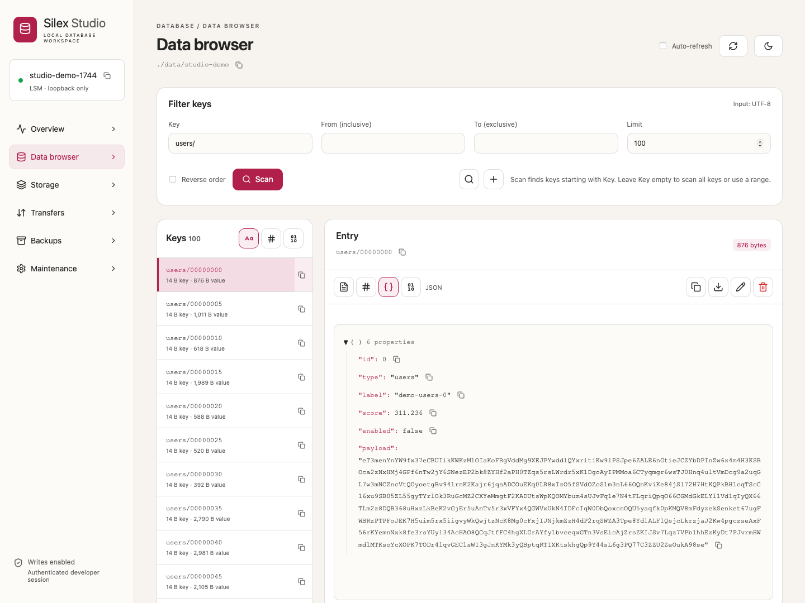

# Silex

Silex is an embedded, log-structured merge-tree (LSM) storage engine for .NET. It is a single-process,
in-process key/value store designed for high write throughput and low allocation. Data is buffered in
memory, persisted to immutable sorted-string tables (SSTs) on disk, and compacted in the background to
bound read and space amplification.

## Branches and NuGet feeds

| Branch / tag | Purpose | Package feed |
| --- | --- | --- |
| [`v*.*.*` tags](https://github.com/sebastienros/silexdb/tags) | Stable Silex releases. | [](https://www.nuget.org/packages/Silex) |
| [`main`](https://github.com/sebastienros/silexdb/tree/main) | Latest Silex development changes. | [](https://f.feedz.io/sebastienros/silexdb/nuget/index.json) |

Successful builds pushed to `main` publish preview packages for `Silex` and `Silex.Keys` to Feedz.
Versions follow `1.0.0-preview-<run number>`, using the GitHub Actions build run number.
Tagged releases publish both packages to NuGet.org.

Add the preview feed alongside NuGet.org, then install the latest prerelease version:

```shell
dotnet nuget add source https://f.feedz.io/sebastienros/silexdb/nuget/index.json --name silex-preview
dotnet add package Silex --prerelease
```

## Features

- **Byte-oriented key/value store** – core writes copy borrowed bytes into Silex-owned memtable memory.
- **Durable** – an optional write-ahead log (WAL) recovers unflushed data after a crash.
- **Zero-copy reads** – values served from memory are returned as read-only borrows of engine-owned
  memory rather than defensive copies.
- **Bounded ordered reads** – owned batches, inclusive/exclusive bounds, forward/reverse traversal,
  live LSM cursors and independently retained MVCC snapshot cursors.
- **Optional MVCC** – stable snapshots and optimistic transactions are available through a separate facade,
  without adding sequence checks or larger internal keys to the default store.
- **Pluggable compaction** – choose `Tiered` (write-optimized), `Leveled` (read-optimized), or `None`.
- **Bloom filters and a block cache** – skip SSTs that cannot contain a key and cache hot blocks.
- **Adaptive SST compression** – LZ4 by default, optional Zstandard or none, with raw fallback for
  blocks that do not compress enough.
- **Multi-targeted** – builds for `net8.0` and `net10.0`.

## Requirements

- .NET 8.0 or .NET 10.0 SDK (see `global.json`).

## Building and testing

```bash
dotnet build Silex.slnx
dotnet test  Silex.slnx
```

## Database CLI

`Silex.Tool` installs the `silex` command with .NET SDK 10 or later:

```bash
dotnet tool install --global Silex.Tool
silex init --db ./data
silex put --db ./data --key user:42 --value-file ./user.json
silex get --db ./data --key user:42
silex scan --db ./data --prefix user: --limit 100
silex stats --db ./data --json
silex backup --db ./data --to ./checkpoint
silex restore --from ./checkpoint --to ./restored
silex verify --db ./restored --json
```

Native AOT packages target **win-x64, osx-arm64, and linux-x64**. Other platforms use the
framework-dependent `any` package, which requires the .NET 10 and ASP.NET Core 10 runtimes
(both included in the SDK). Installation selects
the package automatically. Build from source with `dotnet run --project src/Silex.Tool -- --help`.

| Command | Purpose |
|---|---|
| `init` | Create a database in an empty directory. |
| `info`, `stats` | Inspect files, physical structure, health, and since-open activity counters. |
| `get`, `put`, `delete` | Read or mutate a byte-oriented key. |
| `scan` | Stream ordered entries as JSONL with base64 `key` and `value` fields. |
| `import`, `export` | Stream logical records in bounded batches using JSONL or a checksummed binary dump, optionally gzip-compressed. |
| `backup`, `restore` | Create or restore an independently recoverable physical checkpoint. |
| `verify` | Check offline recovery files and report integrity findings. |
| `serve` | Host one database on authenticated loopback HTTP. |
| `ps`, `stop NAME` | List registered servers or request identity-checked graceful shutdown. |

Offline commands exclusively own the database directory and fail if an application/server
already owns it. `get`, `scan`, `info`, and `stats` use strict read-only opening: they apply normal recovery
validation without skipping damaged recovery, and never flush, compact, or rewrite
recovery files. They may create the persistent `LOCK` file. They do not create missing databases.
`init` and `serve --create` are explicit creation operations. Offline backup opens a writable
handle for recovery and closes it normally afterward.

Specify `--mode mvcc` for an MVCC database and its backups; the default is plain `lsm`.
MVCC reads expose logical user keys, and each scan retains one snapshot. Online plain LSM
scans are live across batches, not historical snapshots. Use `--no-wal` to match a store
created without WAL. CLI/server WAL-enabled writes request file-content synchronization;
the filesystem/device and directory-durability limitations of the engine still apply.
Offline activity counters describe the inspection handle, not previous application activity;
online statistics come from the actual running storage instance. Physical sizes are not
logical key counts.

Keys default to literal UTF-8 bytes; `--key-encoding hex` and `--key-encoding base64` are
available. Value arguments use `--value-encoding utf8|hex|base64`. A `put` requires exactly
one of `--value` and `--value-file`; `--value-file -` reads raw stdin. An empty `--value ""`
is valid. `get --value-encoding raw` writes exact bytes to stdout with no trailing newline.
Text output uses strict UTF-8 and rejects invalid text rather than replacing bytes.
These encodings do not infer an application's typed serializers or composite-key schema.
Scans support `--prefix` or `--from`/`--to` bounds (upper exclusive), `--reverse`, and an explicit
limit of 1 through 1,000,000 entries (default 100). Entry payloads and point values are bounded
at 16 MiB; scans use pooled, bounded batches rather than materializing the database.

Reports are formatted JSON by default; `--json` selects compact JSON. Diagnostics go to
stderr. Exit codes are `0` for success, `1` for errors/cancellation/invalid arguments, and `2`
for a missing key. A failure or lost connection after submitting a mutation does not prove
that it did not commit. The tool never automatically retries mutations.

### Bulk import and export

`export` transfers current logical key/value bytes, not SST files, tombstones, MVCC history,
or application serializer definitions. `backup`/`restore` remain the physical recovery mechanism.
Exports can move data between plain LSM and MVCC stores. Keys must be nonempty, values may be empty,
and each record is limited to 16 MiB of decoded key plus value bytes.

```bash
silex export --db ./data --to ./dump.jsonl
silex export --server local --to ./dump.silex.gz --format binary --gzip
silex init --db ./other --mode mvcc
silex import --db ./other --mode mvcc --from ./dump.silex.gz --json

# Filter an export; the upper key bound is exclusive.
silex export --db ./data --prefix user: --to ./users.jsonl
silex export --db ./data --from user:100 --to-key user:200 --reverse --to ./range.jsonl

# '-' means stdout/stdin. Enable pipefail to surface an upstream export failure.
set -o pipefail
silex export --db ./data --to - --format binary | silex import --db ./other --mode mvcc --from -
```

Export defaults to **JSONL**, matching `scan`: one UTF-8 object per line containing exactly
`key` and `value` base64 strings. Import also accepts a final record without a newline and
CRLF line endings. JSONL is inspectable and interoperable, but does not detect truncation
exactly at a complete-record boundary. Encoded JSONL lines are bounded to
`16 MiB * 4 / 3 + 128` bytes; unusually escaped or whitespace-heavy representations may
reach that bound before the decoded payload limit. **Binary** avoids base64 expansion and validates
each complete block before staging its records. Import defaults to `--format auto`, detecting
the binary header or JSONL and optional gzip by content, not filename. `--format jsonl|binary`
can require a particular format. Gzip imports require one complete member with a valid
CRC32/size trailer. Use single-member gzip files; concatenated members are not supported.

The version-1 binary format uses the eight ASCII bytes `SILEXKV1`, followed by blocks.
All integers are unsigned and little-endian:

| Structure | Layout |
|---|---|
| Block header | `uint32 payloadBytes`, `uint32 records`, `uint32 CRC32` of the payload (IEEE CRC32). |
| Record | `uint32 keyBytes`, `uint32 valueBytes`, raw key, raw value. |
| Completion footer | Three zero `uint32` fields, then `uint64 totalRecords`; no bytes may follow. |

Writers target 1 MiB blocks, permitting a single larger record up to the entry limit.
Readers reject blocks larger than 16 MiB plus the eight-byte record header, invalid lengths,
record-count mismatches, checksum failures, unsupported versions, and missing completion footers.

Imports require an existing database, upsert in input order (the last duplicate key wins),
and leave other keys untouched. They commit at most 1,024 records or approximately 1 MiB of
payload per batch; a larger permitted record occupies its own batch. LSM uses one WAL frame
per batch and MVCC uses one transaction. WAL-enabled hosts/imports request synchronous
file-content durability per batch. The whole import is **not atomic**: failures report the
number of records in confirmed committed batches, discard uncommitted work, and never retry.
A storage failure or lost connection may leave the current batch's outcome uncertain.
Counts describe input records, not distinct keys. Normal completion diagnostics go to stderr;
`import --json` emits the final count/batch report on stdout.

Exports have no default row limit and stream using pooled buffers and bounded read batches.
Offline exports use read-only opening and exclusive directory ownership. Online MVCC exports
retain a snapshot; online plain-LSM exports block all host mutations until streaming completes
or aborts. Use `export --server NAME --live` to allow concurrent writes and explicitly accept
a non-snapshot plain-LSM traversal. Online imports serialize host mutations for the transfer
while permitting reads. Bulk HTTP requests have a 15-minute deadline instead of the normal
30 seconds, and use the same eight-request concurrency bound. File outputs refuse overwrite
and are written beside the destination under a temporary name, then renamed only after
successful completion; stdout cannot provide that publication guarantee.

### Local database host

The same executable can own a database and expose the operations over HTTP using
ASP.NET Core Minimal APIs:

```bash
# Blocking foreground host. Ctrl+C drains requests and closes storage.
silex serve --db ./data --name local --allow-writes --backup-root ./backups

# Independent background process. Returns only after authenticated readiness.
silex serve --db ./data --name local --allow-writes --backup-root ./backups --detach
silex ps --json
silex put --server local --key user:42 --value active
silex get --server local --key user:42
silex stats --server local --json
silex backup --server local --to checkpoint-001
silex stop local
```

The developer-only host binds exclusively to `127.0.0.1` and `::1` on the same port,
automatically assigned unless `--port` is supplied. IPv6 URLs use brackets, for example
`http://[::1]:12345`. The registry advertises the IPv4 URL by default; clients accept either
literal loopback address. Non-loopback peers and wildcard/non-loopback listener configuration
are rejected. Startup fails if either listener cannot bind; it never falls back to a public
interface. Each process hosts one database. Writes are disabled unless `--allow-writes`
is enabled; backup capability requires `--backup-root`. Online backup destinations are simple
names under that root, must not already exist, and cannot contain path separators. Backups
pause writes while copying but keep the database open. Restore and integrity verification
remain offline.

Configuration can come from a JSON file:

```json
{
  "name": "local",
  "database": "./data",
  "mode": "lsm",
  "port": 0,
  "allowWrites": false,
  "backupRoot": "./backups",
  "useWriteAheadLog": true
}
```

Run `silex serve --config ./silex.json --detach`. Explicit command-line options override
configuration, including boolean options supplied with `true`/`false`. File-relative paths
resolve relative to the configuration file; command-line paths resolve relative to the current
directory. Unknown configuration properties are rejected. `--create` (or JSON `create: true`)
requires an empty directory and is intended for first creation, not subsequent restarts.

Each `serve` startup generates a fresh random 256-bit bearer token and atomically publishes
it with the server instance ID in `.silex-server.json` inside the database directory.
The CLI reads this sidecar without opening the database. It is removed on normal shutdown
before database ownership is released; after a crash, the next startup replaces it with
fresh credentials. Tokens are not database records and are excluded from logical exports
and Silex physical backups.

The database directory is the authentication trust boundary: processes that can read the
credential file can administer the server. The sidecar uses normal file-creation permissions
and inherits Windows directory ACLs, rather than imposing a separate current-user-only policy.
Restrict filesystem access to the database directory to control who can connect.

The per-user registry contains only discovery metadata, not tokens:
`LocalApplicationData/Silex/servers` (override with `SILEX_STATE_DIRECTORY`). Unix registry
directories use mode 0700 and files 0600; Windows registry state uses a current-user-only ACL.
`ps` never prints tokens and reports unreachable records without treating them as proof of a
running process. `stop` uses authenticated instance identity, not PID-based killing, and waits
for directory ownership to be released. Detached startup/shutdown failures return errors;
startup logs are stored beside the server record. Detached hosts are not installed OS services
and do not restart automatically. Do not delete server state, credential sidecars, or lock files while a server is running.
This host is a local developer tool, not a production database service. It does not expose
existing application-owned databases or support remote binding. Remote access, TLS, richer
authentication/authorization, and other production policies belong in a custom database
provider or application-owned hosting layer.

The versioned `/v1` protocol uses JSON requests, raw bytes for point-read responses, and
base64 JSONL for scans. It provides identity, info/statistics, read, scan, put/delete, backup jobs,
stop operations, and streaming logical imports/exports. Hosts admit at most eight concurrent
requests, bound entry payloads and scan buffers, and normally limit requests/snapshot retention
to 30 seconds (15 minutes for bulk transfers). Import bodies can exceed the point-request
limit but are decoded incrementally under the per-record bounds. Backup jobs run independently
of client polling; disconnecting the client does not cancel a submitted backup. Shutdown cancels
and drains the job, and the last 64 job results are retained for polling. No borrowed engine
memory is retained across network awaits.

### Embedded administration UI



```bash
silex ui --db ./data --name local --allow-writes --backup-root ./backups
silex ui --server local
# Print a credentialed URL instead of opening the browser:
silex ui --server local --no-open
```

`ui --db` starts a detached host for an existing database; it remains running until
`silex stop NAME`. Use `init` first for new databases. `ui --server` attaches without
opening the database directory or changing host permissions. Writes remain opt-in.
The URL printed by `--no-open` is a credential: do not share it or capture it in logs.
The browser removes the token fragment from the address bar, retains it in session storage,
and sends it only in API authorization headers. Static UI assets contain no secrets and
are public on the loopback listener; all database APIs still require the bearer token.

Silex Studio provides overview charts, byte-safe key/value editing, prefix/range scans,
published SST metadata, logical import/export, backup jobs, and guarded flush/compaction.
The data browser has filters above a split view: keys and exact key/value sizes on the
left, with no value previews, and an entry inspector on the right. Text inputs disable
autocomplete. The single **Key** field is a prefix filter for scans and an exact key for
reads and entry creation; leave it empty to scan all keys or use From/To range bounds.
Press Enter in a filter input to submit a scan.
Icon toolbars select key rendering (UTF-8, hex, Base64) and value formats.
Small copy icons beside keys, JSON scalar values, server names, database paths,
SST filenames/bounds, and backup operation IDs copy the complete value, even when
the display is truncated. JSON strings copy their decoded text; numbers retain
their exact original literals.
Successful copies show a checkmark with a "Copied" tooltip for two seconds instead
of a notification banner; clipboard failures remain explicit errors.
Select a scan result or read a key to inspect its stored bytes as UTF-8 text, a paged
hex/ASCII dump, collapsible JSON, or Base64. Automatic selection prefers valid JSON,
then UTF-8 text, then hex. JSON preserves number literals, duplicate properties, and
escaped strings; invalid UTF-8/JSON produces explicit viewer errors. Viewing never
rewrites data. The **Edit entry** icon turns the viewer into an inline editor in the
currently selected format, including formatted JSON and hex bytes. Format changes
convert draft bytes without reinterpreting them; invalid conversions are rejected.
Saving JSON requires valid JSON. Unchanged drafts preserve the original stored bytes,
including JSON whitespace. Leaving an editor or selecting another entry requires
confirmation before its draft is discarded. Raw downloads always use stored bytes.
Copy uses the displayed representation (the current hex page or text/Base64 preview);
raw downloads contain the complete original value. Text/Base64 previews show at most
65,536 characters. JSON previews support values up to 256 KiB and 64 nesting levels,
with children loaded in groups of 50. Use text or raw downloads beyond those limits.
SST metadata is copied from the engine under its structure lock, excluding obsolete files.
Key bounds are physical encoded keys, including MVCC versions, not logical row counts.
Browser scans are limited to 1,000 rows and 16 MiB responses; browser export downloads to
256 MiB. Use the streaming CLI for larger transfers. Imports are batched upserts and
may leave confirmed partial progress. Restore and integrity verification remain offline.

Frontend source is in `src/Silex.Tool/Ui` (React, TypeScript, Vite). Building the tool
requires Node 22+ and npm in addition to the .NET SDK. MSBuild builds the frontend
incrementally and embeds all generated assets; installed native and portable tools need
no Node, external asset directory, CDN, or network access to load the UI.

### Tool packaging

Build all packages at the same version with .NET SDK 10 or later:

```bash
dotnet pack src/Silex.Tool -c Release -p:Version=1.0.0 -o artifacts
dotnet pack src/Silex.Tool -c Release -r any -p:PublishAot=false -p:Version=1.0.0 -o artifacts
# Run each native pack on the matching operating system.
dotnet pack src/Silex.Tool -c Release -r win-x64 -p:Version=1.0.0 -o artifacts
dotnet pack src/Silex.Tool -c Release -r osx-arm64 -p:Version=1.0.0 -o artifacts
dotnet pack src/Silex.Tool -c Release -r linux-x64 -p:Version=1.0.0 -o artifacts
```

Publish the RID and `any` packages first, then the top-level `Silex.Tool` pointer package.
The release workflow builds the native packages on matching runners and enforces that order.

## Getting started

Open (or create) a store, write some entries, read them back, and close it to flush to disk.

```csharp
using Silex;

var options = new StorageOptions();

// The directory is created if it does not exist. The core API stores encoded bytes.
await using var db = await LsmStorage.OpenAsync("my-db", options);

db.Put(1, "one");
db.Put(2, "two");

string? value = await db.GetStringAsync(1);   // "one"
string? missing = await db.GetStringAsync(99); // null when absent

db.Delete(2);

// Closing (or disposing) flushes pending data to disk and stops background work.
await db.CloseAsync();
```

`LsmStorage.OpenAsync` reopens an existing store at the same path, replaying the WAL and loading existing
SSTs, so persisted data survives process restarts.

### Bounded, lifetime-safe ordered reads

Use an owned cursor/batch instead of borrowed callbacks when processing may await or reenter storage:

```csharp
var range = new OrderedReadRange("user:"u8.ToArray(), lowerInclusive: true,
    "user;"u8.ToArray(), upperInclusive: false);
using var cursor = db.CreateOrderedReadCursor(range, OrderedReadDirection.Forward);
while (true)
{
    using var batch = await cursor.ReadBatchAsync(maxEntries: 128, maxBytes: 64 * 1024, cancellationToken);
    for (var i = 0; i < batch.Count; i++)
    {
        var entry = batch[i]; // ReadOnlyMemory<byte> key and value, owned by this batch
        await ProcessAsync(entry.Key, entry.Value);
    }
    if (batch.IsExhausted) break;
}
```

Bounds use lexicographic **encoded byte order**, not a typed comparer. `OrderedReadRange` copies its
inputs; null is unbounded and empty memory is a bound on the empty key. Reversed endpoints and equal
endpoints with either endpoint exclusive form an empty range. Plain SST encoding still requires
nonempty stored keys; MVCC supports empty logical keys. `Reverse` uses the same ascending indexes.
Tables/blocks outside the interval are pruned, and memory sources seek into the interval without
materializing the range. Each successful advance resumes strictly beyond the last returned logical
key in its direction. Full batches conservatively report `IsExhausted == false`; the next advance may
return an empty exhausted batch. Once exhaustion is observed the cursor stays exhausted.

`maxEntries` and `maxBytes` must both be positive. `PayloadBytes` is exactly the sum of returned key
and value lengths, excluding descriptors, pool slack, MVCC encoding and internal block buffers.
Entries are never split. If the next entry does not fit the remaining byte budget, the batch stops
before it. If that entry alone exceeds `maxBytes`, the advance throws `ArgumentException` without
moving the cursor; retry with a larger budget. The limits bound **returned payload**, not all engine
working memory: one source record per overlapping table, decoded SST blocks, the memtable's sorted
index, and (for reverse MVCC) one candidate version are additionally retained during an advance.
Large individual entries can therefore require internal memory even when rejected by the batch limit.
Transaction cursor creation copies only current in-range mutations into pooled storage and sorts their
descriptors once; it does not materialize stored entries or copy stale overwritten values/tracked reads.
This frozen overlay lives until cursor disposal and is not bounded by per-batch payload limits. Each
advance binary-seeks the overlay continuation and merges it with the shared bounded MVCC traversal.

The consistency model is explicit on `cursor.Consistency`:

- **`Live`** (`LsmStorage.CreateOrderedReadCursor`): no historical or atomic snapshot, even within
  an advance. Concurrent replacements/deletions may affect unread entries; inserts ahead of the
  continuation may appear, while changes behind it are not revisited. Do not use this as a stable
  export under concurrent writes.
- **`Snapshot`** (`MvccStorage`, `MvccSnapshot`, or `MvccTransaction.CreateOrderedReadCursor`):
  every batch reads `cursor.Sequence`. A snapshot-created cursor retains that exact sequence
  independently, including after disposing the originating snapshot. Later mutations remain invisible,
  and garbage collection preserves required versions until the cursor is disposed.

`transaction.CreateOrderedReadCursor(range, direction)` reads the transaction's **exact starting
sequence**, merged with pending inserts/replacements and with pending deletions suppressed. Each
logical key appears once in encoded byte order. The pending-write overlay is copied and **frozen at
cursor creation** (statement start): later `Put`/`Delete` calls do not change an open cursor or cause
updates to revisit newly written index entries. Create another cursor for a later statement's writes.
Point reads continue to see the transaction's current pending writes.

Transaction cursors own their overlay and retain their snapshot independently. They remain readable
after transaction disposal, successful commit, conflict, or canceled/failed commit, subject to the
store's health/shutdown contract; a failed commit that faults storage also prevents cursor advances.
Cursor creation and all other operations on a transaction are single-consumer and must not overlap.
After creation, a cursor advances independently and may overlap subsequent transaction operations.
Range reads **do not track point or interval dependencies**, including empty ranges and returned
keys. Use `GetForUpdateRawAsync` for point dependencies and `TrackReadRange` to opt in to interval
(phantom) validation; the default is snapshot isolation, not serializability.

No blocking storage lock or borrowed engine memory survives an advance. Independent lookups,
mutations, maintenance, and network awaits are allowed between advances. Internal traversal holds a
structural read lock only while building a batch, briefly locks memory-source reads, and checks
cancellation per physical entry (including tombstones/invisible versions) and block load. Synchronous
lock acquisition, index sorting, individual decode/copy operations and OS reads are not interruptible.
Paging reseeks indexes rather than retaining physical iterators or rescanning from the range start;
very small batches pay repeated source/index setup, and reverse MVCC must resolve a key's version
group before returning its newest visible value.

Cursor advance/disposal must not overlap; overlapping operations throw `InvalidOperationException`.
Cancellation, oversized-entry errors and read faults dispose partial batches and leave continuation
unchanged. Existing health/fault contracts still apply. Closing storage does not wait for idle cursors;
mutable-source reads recheck health while holding the memory-table lock, so readers waiting behind a
failed batch cannot return its partial application. Already admitted immutable/SST reads remain safe.
new advances (even on exhausted cursors) reject a closed/faulted store. Returned batches remain valid
after later advances, cursor disposal, maintenance, or storage closure, until **their own disposal**.
Do not dispose a batch while another operation still uses its memory. Dispose snapshot cursors promptly
to avoid indefinite version retention; there is no engine expiry. Continuation tokens across process
restarts, token expiry and projections are not part of this API.
Existing callback APIs retain their borrowed-span and callback lock-lifetime contracts unchanged.

### Prefix-bounded logical keyspaces

`PrefixKeyspace` is an immutable, reusable helper over **fully encoded keys including the prefix**.
It does not add table/collection semantics, key encoding, separate stores, column families, or another
transaction implementation. Choose distinct, non-overlapping binary prefixes for independent namespaces:

```csharp
var records = new PrefixKeyspace([0x10]);
var indexes = new PrefixKeyspace([0x20]);
using var tx = mvcc.BeginTransaction();
records.Put(tx, [0x10, 1], "record"u8);
indexes.Put(tx, [0x20, 7], [1]);
using var cursor = records.CreateOrderedReadCursor(tx); // starting snapshot plus frozen own writes
await tx.CommitAsync(); // both namespaces publish atomically
using var batch = await cursor.ReadBatchAsync(128, 64 * 1024);
```

The helper owns only its copied prefix. Supply a `LsmStorage`, `MvccStorage`, `MvccSnapshot`, or
`MvccTransaction` to each supported operation. Use the **same transaction** across handles for atomicity,
the same snapshot for a consistent cross-handle view, or one caller-owned `LsmWriteBatch` for plain-LSM
batch staging (then call `storage.Write(batch)`). It neither creates nor disposes any of these objects.
Sharing a helper is safe; transactions, batches and cursor operations retain their single-consumer rules.
Reusing it with another store is allowed but provides no cross-store atomicity.

Point reads/writes/deletions, tracked point reads, and all multi-get keys must begin with the prefix;
out-of-prefix requests throw `ArgumentException` before forwarding or staging anything. Validated point
and multi-get calls add no key-copy allocations. Inputs to multi-get must stay unchanged until completion.
Ordered reads, range dependencies and transactional range deletion reuse existing bounded traversal.
Omitted bounds are capped to the keyspace; explicit bounds must belong to it, except an exclusive upper
bound exactly at the prefix successor. Escaping bounds throw rather than silently clipping a request.
`BoundRange` exposes the same validation for composing other encoded-range operations.

The full prefix interval is `[prefix, successor(prefix))`: increment the rightmost non-FF byte and
truncate the trailing bytes to compute the successor. The prefix key itself belongs to the namespace.
An all-FF prefix has no finite upper bound; every key at or above it begins with that prefix. An empty
prefix covers the whole logical store, including MVCC's empty key (plain SST keys still must be nonempty).
Overlapping prefixes intentionally overlap; this is convenience/isolation for helper-mediated operations,
not a security boundary against direct access to storage.

Cursor entries, range-deletion `Remaining` bounds, dependency diagnostics and payload budgets retain
the **full encoded keys**, with no stripping or re-encoding. Pass `Remaining` back unchanged to
`keyspace.DeleteRangeAsync(tx, maxEntries, remaining)` in a new transaction. Ordinary reads/cursors do
not track dependencies; use `GetForUpdateRawAsync` or `TrackReadRange` when needed. Existing savepoints,
limits, group commit, conflict diagnostics, snapshot/cursor/batch lifetimes, cancellation, failure outcomes,
health and shutdown contracts apply unchanged. No callback scan wrapper is added: use the lifetime-safe
bounded cursor API rather than filtering an unbounded borrowed scan.

### Order-preserving composite keys (`Silex.Keys`)

`Silex.Keys` is an optional companion library (it does not reference or change the storage engine, and
no on-disk format changes) that builds byte-ordered composite keys: unsigned byte-wise comparison of two
keys equals component-by-component comparison of their tuples. It is shared encoding machinery, not a
definition of any database's value ordering: SQL coercions, collations and NULL ordering, and
JSON/document comparison stay in the layer using it.

```csharp
using Silex.Keys;

Span<byte> buffer = stackalloc byte[64];
var writer = new OrderedKeyWriter(buffer);
if (!writer.TryWriteString("orders") ||
    !writer.TryWriteInt64(customerId) ||
    !writer.TryWriteUInt64(timestamp, OrderedKeyOrder.Descending))
{
    // buffer too small: size it with OrderedKey.GetStringLength / Int64Length / UInt64Length
}
db.Put(writer.WrittenSpan, value);

var reader = new OrderedKeyReader(key);
reader.TryReadString(chars, out var charCount);
reader.TryReadInt64(out var id);
reader.TryReadUInt64(out var ts, OrderedKeyOrder.Descending);
```

Everything is span based and allocation free; the caller owns all buffers.

* **Components** (each with `Ascending` or `Descending` order): `Boolean`, `Bytes`, `String`, `Int64`,
  `UInt64`, `Double`, `Decimal`.
* **Format.** Each component begins with a tag (`04`/`05` boolean false/true, `10` bytes, `11` string,
  `20` int64, `21` uint64, `22` double, `23` decimal); a descending component uses the bitwise complement of its entire
  encoding, including the tag. Integers are big-endian (int64 with the sign bit flipped). Doubles use the
  IEEE-754 bit transform giving `-Infinity < negatives < -0.0 < +0.0 < positives < +Infinity < NaN`; every NaN
  is written as one canonical NaN, so NaN payloads are not preserved. Bytes and strings escape each `00`
  as `00 FF` and end with `00 01`. Strings use **Unicode code-point order through strict UTF-8 byte ordering**;
  no case folding or collation is applied. This is not interchangeable with .NET's UTF-16
  `StringComparer.Ordinal`: U+10000 sorts after U+FFFF here, but before it in UTF-16 ordinal order.
  Query evaluators must use comparison semantics consistent with their index encoding.
* **UTF-8 strings.** `TryWriteUtf8String(ReadOnlySpan<byte>)` accepts decoded string content encoded as UTF-8,
  not a JSON token, and writes exactly the same `String` component as `TryWriteString` for equivalent text
  (for example `"café"` and its UTF-8 bytes). Both use the existing tag, escaping and terminator, with no
  on-disk format change. `GetUtf8StringLength` reports the exact encoded size, and
  `TryReadUtf8String(Span<byte>, out int length)` reads the unescaped UTF-8 into caller-owned memory.
  Malformed UTF-8 (including overlong sequences, surrogate code points, truncation and out-of-range code
  points) is never replaced: sizing/writing throw `ArgumentException` before writing, even with insufficient
  capacity, and reading returns `Malformed` without advancing, even with an undersized destination.
  `TryWriteString` likewise rejects unpaired UTF-16 surrogates. JSON unescaping belongs to the document
  layer: JSON `"a"` and `"\u0061"` must reach these APIs as the same decoded content.
* **Decimal.** A fixed 25-byte component: tag `23` followed by a 24-byte two's-complement big-endian integer
  with its highest bit flipped. For unsigned 96-bit coefficient `C`, scale `s` in `[0,28]` and sign, the
  integer is `N = +/-C * 10^(28-s)`, computed entirely with integer arithmetic. Its maximum magnitude
  `(2^96-1) * 10^28` needs 190 bits. Descending complements all 25 bytes, including tag `DC`.
  Equal decimal values have identical keys regardless of trailing-zero scale or zero sign. Decoding returns
  the minimum possible scale, with positive scale-zero zero; it preserves value, not the original decimal bits.
  A payload must be exactly representable as a decimal: even in-range integers such as `N = 2^96` are
  rejected when removing trailing zeros cannot reduce the coefficient to 96 bits. Reads, peeks and skips
  reject malformed decimal payloads without advancing. Existing kinds' bytes and semantics are unchanged.
* **Boundaries.** No component encoding is a byte prefix of another, so tuple boundaries are
  unambiguous and the raw key bytes of a tuple prefix (for example `writer.WrittenSpan`) are exactly the byte
  prefix of every longer tuple that starts with it, which composes with `PrefixKeyspace`. Different kinds
  order by tag (Boolean < Bytes < String < Int64 < UInt64 < Double < Decimal, then descending kinds); numeric
  kinds are never interleaved by magnitude, and position-wise consistent schemas are the caller's concern.
* **Buffers.** `TryWrite*` returns `false` when the exact encoded size does not fit, leaving
  `Written` unchanged; sizes are `OrderedKey.BooleanLength` (1), `Int64Length`/`UInt64Length`/`DoubleLength` (9),
  `DecimalLength` (25), and `GetBytesLength`/`GetStringLength`/`GetUtf8StringLength`. Readers return an `OrderedKeyDecodeStatus`
  (`EndOfData`, `UnexpectedComponent`, `Malformed`, `DestinationTooSmall` with the exact required length) and
  do not advance on failure. String read lengths are UTF-16 characters for `TryReadString` and UTF-8 bytes
  for `TryReadUtf8String`. Decoding is strict, so each key has exactly one decoding.
* **Limits.** Sizes are `int`-bounded, and keys remain subject to the storage engine's own key limits.
  No NULL, date/time, GUID, or case-insensitive components are defined; layers can compose them from
  these building blocks (for example a leading boolean or `UInt64` marker for NULL placement). The format is
  versionless and its encodings are fixed; future component kinds would use new tags.

Decimal normalization does not introduce mixed-type numeric equality: `Int64(1)`, `Double(1.0)` and
`Decimal(1.00)` remain distinct keys in separate tag-ordered regions. Unified SQL/JSON numeric comparison
requires a separate encoding or coercion policy; converting all numbers to `Double` loses integer
distinctions above `2^53` and decimal precision. Double still distinguishes negative and positive zero.

### Batched point reads

`MvccSnapshot`, `MvccStorage` and `MvccTransaction` expose `ReadManyRawAsync(keys, maxBytes)`, a generic
multi-get against **one** consistent view: the snapshot's exact sequence, the sequence captured once for a
store call, or a transaction's starting sequence overlaid with its pending writes and deletions. It is for the
index-to-record pattern: read identifiers with a cursor, then resolve them together.

```csharp
using var ids = await cursor.ReadBatchAsync(64, 4096);
var keys = new ReadOnlyMemory<byte>[ids.Count];
for (var i = 0; i < keys.Length; i++) keys[i] = ids[i].Value;
using var records = await snapshot.ReadManyRawAsync(keys, maxBytes: 1 << 20);
for (var i = 0; i < records.Count; i++)
{
    if (records.TryGetValue(i, out var value)) { /* record bytes */ }
}
```

Results are positional (duplicates and misses allowed) and owned by the `PointReadBatch` until it is disposed,
independent of the snapshot and store. `maxBytes` bounds value bytes: when the next value would exceed it, the
batch stops early (`IsComplete == false`, `Count` leading keys resolved) and the caller continues with
`keys.AsMemory(batch.Count)`; a first value larger than `maxBytes` throws. Keys must stay unchanged until the
call completes. Transaction reads are untracked like `GetRawAsync`; use `GetForUpdateRawAsync` for dependencies.
Cancellation, health/shutdown and disposal behave like individual point reads, and no engine memory or lock is
held after the call returns. This does not make reads inside scan callbacks safe, and there are no joins or
record hydration.

Batching provides one consistent view and bounded owned results; it does not imply higher throughput.

### Recovery, integrity, and salvage

For strict offline read-only access, use `LsmStorage.OpenReadOnlyAsync` or
`MvccStorage.OpenReadOnlyAsync`. Opening applies normal recovery validation; the handle
exclusively owns its directory and never modifies recovery files, flushes, or compacts.
Unlike salvage, damaged recovery is not skipped. Use `VerifyIntegrityAsync` for a full
data-block audit.

Normal opening refuses a database with a missing manifest-referenced SST, even when a WAL with
the same id survives: that WAL alone does not prove that all committed contents can be recovered.
`StorageRecoveryException.Report` identifies the missing files and recommends restoring a consistent
backup. A failed recovery leaves the committed manifest and source files intact.

Inspect a database **offline**, with no other handle using its directory:

```csharp
var report = await LsmStorage.VerifyIntegrityAsync("my-db", options);
foreach (var issue in report.Issues)
    Console.WriteLine($"{issue.Kind}: {issue.Path}: {issue.Message}");
```

Verification reads live SST metadata and every data block (including checksums, decoding, entry
extents, and index/key ordering), and validates WAL frames needed for recovery. It does not modify
recovery files; verification and salvage may create the persistent `LOCK` ownership file. Orphan SSTs
and stale WALs superseded by verified SSTs are ignored. An incomplete trailing WAL
frame is reported as `IncompleteWalTail`, not an error: earlier committed frames still recover normally.
Missing committed SSTs and corrupt committed WAL frames instead make `IsRecoveryComplete` false.
Checksums cannot detect every possible alteration of legacy formats or unchecksummed metadata;
completeness is relative to the manifest and surviving WALs, not a substitute for backups.
Legacy stores without a manifest remain supported, but missing files in those stores cannot be detected.

For explicit best-effort extraction, open a **read-only** salvage handle:

```csharp
await using var salvage = await LsmStorage.OpenSalvageAsync("my-db", options);
Console.WriteLine($"Complete: {salvage.RecoveryReport!.IsRecoveryComplete}");
await salvage.ScanRawAsync(destination, static (db, key, value) =>
{
    db.Put(key, value);
    return true;
});
```

Here `destination` is a different, normally opened database. Salvage skips missing/corrupt SSTs and
retains valid prefixes of damaged WALs. It never deletes evidence, creates WALs, rewrites the manifest,
flushes, or compacts, even on disposal; writes and manual maintenance throw. A corrupt manifest must
be restored before salvage because guessing which SSTs are live can resurrect deleted or obsolete data.
Salvaged results can omit committed data or expose older values/tombstones hidden by a lost newer SST;
review the report and extracted data before replacing the original database. Use the same WAL setting
as the original store when opening either normally or for salvage.

Use `LsmWriteBatch` when several byte-oriented mutations can share one durability boundary. The batch is
written as one checksum-protected WAL frame, reducing write and `fsync` calls while preserving the default
process-crash recovery and optional file-content synchronization boundaries:

```csharp
var batch = new LsmWriteBatch();
batch.Put("user:1"u8, "active"u8);
batch.Delete("user:2"u8);
db.Write(batch);
```

### Physical backup/checkpoint and restore

Create an independently recoverable checkpoint while the source remains open:

```csharp
await db.CreateBackupAsync("my-db-backup");
await LsmStorage.RestoreBackupAsync("my-db-backup", "my-db-restored", options);
await using var restored = await LsmStorage.OpenAsync("my-db-restored", options);
```

The checkpoint captures one serialized write boundary, including all previously completed writes
and excluding writes acquired afterward. It holds the maintenance and write locks while copying:
compaction cannot replace/delete required SSTs, and writers cannot append or rotate the copied WALs.
The committed manifest, live SSTs, and current/rotated/recovered WALs form the recovery set; orphans,
stale WALs, temporary files, and the source `LOCK` are not copied. WAL-disabled stores instead write
their memory tables into backup-only SSTs. The source is not flushed or otherwise modified.
This favors a simple correctness boundary over uninterrupted writes during large backups.

`MvccStorage.CreateBackupAsync` additionally holds the commit gate, preserving a published sequence
and complete transaction/group-commit boundaries. Staged transactions and subsequent commits are
excluded. Stored versions are preserved, but live snapshot/transaction objects do not transfer.
Use `MvccStorage.RestoreBackupAsync` and reopen through `MvccStorage`; the restore also checks MVCC
format and sequence metadata. Backups from the wrong facade are rejected.

Both APIs require an empty destination (a persistent `LOCK` alone is allowed), exclusively own it
until completion, and never overwrite existing data. Restore also exclusively owns the backup source.
Neither directory may contain the other; directory aliases are resolved and recovery-file links are
rejected. External file/directory replacement while these operations run is unsupported, just as with
an open database. Use matching encoding factories and enable WAL recovery if the backup contains WALs.
Keep completed backup directories **immutable**: do not open them as writable stores. Restore copies
them without consuming them, so one backup can restore multiple independent databases.

A completion inventory records filenames, lengths, and SHA-256 checksums. Creation verifies recovery
integrity before publishing that inventory. Restore validates the inventory and every recovery file,
then verifies the copied files and recovery structure before returning a normally openable destination.
Missing WALs/manifests are detected, even where ordinary legacy recovery could not detect their loss.
Malformed, corrupt, missing, or unexpected files and unfinished copies are rejected. An incomplete
uncommitted WAL tail inherited from source recovery is still recoverable and is not confused with
committed corruption; its exact bytes are protected by the inventory checksum.
Checksums detect accidental changes, not malicious replacement of
both the inventory and files; this is not an authenticated backup format.

Cancellation is checked during copying and verification, and while waiting for maintenance/commit
gates; a synchronous write-lock wait cannot be interrupted. Copying uses bounded pooled buffers and
runs off the caller's synchronization context. Failure/cancellation removes only files created by
that call, leaving the destination directory and its persistent `LOCK`, so it can be retried.
Cleanup errors are reported explicitly as `AggregateException`; do not use that partial destination.
A `backup.pending` guard makes process-interrupted copies reject normal opening and restore. Start
again with an empty destination rather than trying to recover an interrupted copy. Backup/copy failure
does not undo commits or fault an otherwise healthy source. Salvage and faulted sources are rejected.
Do not invoke these APIs from borrowed-read callbacks or wait for shutdown inside one.

Copied/generated files and completion metadata request OS file-content synchronization. As with
`SynchronizeAsync`, directory-entry persistence and power-loss safety depend on the filesystem/device;
Silex does not promise directory synchronization or power-loss certification.

### Durability boundaries and explicit synchronization

**Applied/visible**, **written to the operating system**, and **synchronized** are different boundaries.
Writes are serialized under the mutable-table lock. With WAL enabled, the complete checksummed recovery
frame is written first, then optionally synchronized, then applied in memory. Readers cannot observe a
partially applied successful batch. MVCC additionally publishes its sequence after applying the frame;
only published sequences are visible to new snapshots.

| Configuration | Successful `Put`, `Delete`, `Write`, or MVCC commit guarantees |
|---|---|
| `UseWriteAheadLog = false` (`SyncWriteAheadLogToDisk` ignored) | Entire mutation applied/visible; no recoverable file for unflushed memory, so no process-crash or stable-storage guarantee. |
| WAL enabled, `SyncWriteAheadLogToDisk = false` (default) | Entire mutation applied/visible and complete WAL frame submitted to the OS. Supports process-crash recovery with the OS still running; stable-storage synchronization is not promised. |
| WAL enabled, `SyncWriteAheadLogToDisk = true` | The preceding guarantees, plus successful OS file-content synchronization (`FileStream.Flush(true)`) of the WAL before in-memory application and acknowledgment. |

For a precise explicit boundary without synchronizing every append:

```csharp
db.Put("user:1"u8, "active"u8); // applied/visible and written to the OS
await db.SynchronizeAsync();   // synchronize through this successfully completed write
```

`LsmStorage.SynchronizeAsync` and `MvccStorage.SynchronizeAsync` cover **all writes/commits completed before
the call** (and any racing writes serialized before the barrier acquires the write lock). No guarantee
is made for writes serialized afterward. This is a whole-store barrier, not a write receipt, transaction,
checkpoint, or group-commit API; it does not stage, apply, or publish new mutations. Await a successful
MVCC commit first; pending transaction buffers are excluded.

The barrier blocks writes/rotation and serializes with flush/compaction while requesting disk
synchronization for the current WAL, every rotated or recovered WAL, every live L0/leveled SST, and
finally the manifest. Thus a write is still covered after its original WAL has been flushed/deleted or
its SST compacted. It does not flush memtables or run compaction. Repeated barriers are supported and
may be expensive: they synchronize the live file set, not just a tracked unsynchronized suffix.
WAL-disabled stores throw `NotSupportedException` without faulting, rather than falsely acknowledging
unflushed memory. Read-only salvage stores reject it like other writable-only operations.

Cancellation is honored while asynchronously waiting for the maintenance/MVCC commit gate and once more
after acquiring the synchronous mutable-table lock, before the first file I/O. Waiting for that synchronous
lock cannot be interrupted; file synchronization may run synchronously on the calling thread, and after
file I/O begins cancellation is not polled. Successful completion reports the actual boundary, even if
the token was canceled during synchronization. An admitted barrier is drained by shutdown; new barriers are rejected
once shutdown starts. Do not invoke it from a borrowed-read callback (it requires the write lock).

Flush/compaction synchronize each replacement SST's contents and the new manifest's contents before
retiring the old recovery files, preserving the file-content boundary across maintenance and reopen.
**These are OS file-content synchronization requests, not power-loss certification.** Silex does not
explicitly synchronize directory entries for WAL creation, SST/manifest renames, or file deletion.
Their persistence, the OS/filesystem's synchronization semantics, and device/controller caches still
matter. No configuration or barrier promises survival of every power loss, hardware/media failure, or
filesystem failure. Source inspection and process-crash tests are not power-loss tests.

### Operation failures and instance health

Successful `Put`, `Delete`, `Write`, and MVCC commits apply the entire mutation and reach the
configured WAL boundary. `UseWriteAheadLog = true` writes a complete recovery frame to the operating
system; `SyncWriteAheadLogToDisk = true` additionally requests disk synchronization. With WAL disabled,
success guarantees visibility, not crash durability. These are not guarantees against hardware,
filesystem, or media failure, and process-crash tests do not certify power-loss safety.

Mutation failures originating inside the write engine throw `StorageOperationException`, preserving
the original exception in `InnerException`. Inspect `Outcome` and `Health`, not just the exception type:

| Failure boundary | Outcome | Instance |
|---|---|---|
| Argument validation, caller-side encoding/batch preparation, MVCC conflict, or cancellation before committing starts | Definitely not committed; original validation/cancellation exception, or `false` for `TryCommitAsync` conflicts | Healthy |
| WAL frame preparation fails before any frame bytes are submitted | `NotCommitted` | Healthy |
| WAL write starts and fails (including disk full or a torn write), or synchronization fails | `Indeterminate` | Faulted |
| In-memory mutation/batch application fails after WAL persistence, or while applying with WAL disabled | `Indeterminate`; memory may contain only part of the batch | Faulted |
| The entire mutation reaches its boundary, but subsequent publication or automatic memtable rotation fails | `Committed`; for MVCC, the persisted sequence may not yet be published to readers in this instance | Faulted |

An explicit barrier's I/O failure throws `StorageSynchronizationException` with the original cause in
`InnerException`. The requested synchronization boundary is **unconfirmed** (some or all files may
already have synchronized), and the instance becomes faulted. Previously successful mutations remain
committed to their original acknowledgment boundary; the barrier does not undo them and its exception
is not a mutation's `NotCommitted`/`Indeterminate` outcome. Dispose and reopen, do not retry writes merely
because synchronization failed. Cancellation before file I/O, unsupported WAL configuration, and
read-only rejection leave health unchanged.

`Indeterminate` is deliberately conservative: recovery may apply the entire WAL frame, or discard an
incomplete trailing frame. It never means "nothing committed." A complete checksummed batch frame is
replayed as a whole when recovery succeeds; failed recovery returns no usable instance. With WAL
disabled, unflushed changes can be lost on reopening. Batches must not be mutated concurrently with
`Write`. Deduplication, retry safety, and request identity belong to callers; never blindly retry an
indeterminate mutation.

`LsmStorage.Health` and `MvccStorage.Health` report `Healthy`, `Faulted`, or `Disposed`; `Fault` retains
the first unsafe failure. Faulting is permanent for that instance. New reads, writes, snapshots,
transactions, scans, and maintenance reject it with `StorageFaultedException`. Operations already in
flight may finish; readers waiting for mutable-table access check health before reading, so they cannot
observe a failed batch's partial application. Health inspection and disposal remain available. Health is
an operational state, not an integrity certification: an explicitly salvaged store is usable only for
read-only extraction and still requires inspection of its incomplete `RecoveryReport`.

Cancellation before an ordinary MVCC commit's final write begins throws `OperationCanceledException` and does
not commit. Once writing starts, cancellation is not polled: completion reports the actual write
result rather than a misleading cancellation. With optional group commit, cancellation instead ends at
acceptance after validation and batch preparation (see below). The synchronous byte-store mutations do not accept a
cancellation token.

Flush/compaction failures do not undo previously acknowledged writes. Cancellation before maintenance
starts (including while waiting for its serialization lock) leaves the instance healthy. Once maintenance
starts, any exception, including cancellation, conservatively faults the instance and requires reopening;
the exception itself is propagated to the caller. Background maintenance records failures in `Fault` and
stops instead of silently continuing. Stopping the background loop drains an already-started maintenance
operation rather than canceling it halfway through.

Read cancellation or an exception in a caller's read callback makes no mutations and does not fault the
instance. `CollectGarbageAsync` deletes in atomic per-chunk batches, not one transaction: cancellation
can leave a successfully committed prefix of chunks while the instance remains healthy. Its optional
flush/compaction phase follows the structural-maintenance contract above.

Dispose a faulted instance before reopening the same directory. Faulted disposal stops background work
and releases resources **without flushing partial memory, retrying WAL synchronization, publishing a new
manifest, or deleting recovery files**. Reopening resolves recoverable WAL/manifest state; if it fails,
restore or use explicit integrity/salvage tooling instead of treating the instance as healthy. A failed
`CloseAsync` can fault the instance; subsequent disposal performs this recovery-preserving cleanup.
If creation of the next WAL fails during its header write, the valid header prefix contains no mutations:
strict recovery treats it as an incomplete tail, retains earlier committed WAL frames, and removes the
empty WAL only after opening succeeds. Invalid signatures or corrupt complete headers remain errors.
Directory ownership and shutdown admission are enforced as described below.

## Supported key and value helpers

The core store accepts `ReadOnlySpan<byte>` and copies keys and values into memtable-owned arena blocks.
Convenience extension methods encode the following
types as keys and values:

| Type      | Notes                                                  |
|-----------|--------------------------------------------------------|
| `int`     | Order-preserving (sign-flipped big-endian) key bytes   |
| `uint`    | Order-preserving (big-endian) key bytes                |
| `long`    | Order-preserving (sign-flipped big-endian) key bytes   |
| `ulong`   | Order-preserving (big-endian) key bytes                |
| `string`  | UTF-8 encoded; keys ordered by Unicode code point      |

The internal encoders still define the on-disk representation. Typed helpers use those encoders before
delegating to the byte API.

> **Key ordering.** Keys are encoded in an *order-preserving* form, so the engine can binary-search a
> block by comparing raw encoded bytes on the hot read path — no per-entry key is materialized and no
> allocation occurs. Numeric keys therefore sort by their natural numeric value (negatives before
> non-negatives), and `string` keys sort by Unicode code point (equivalent to UTF-8 byte order), which is
> ordinal — not culture-sensitive.

## Reading and writing

### Put

```csharp
db.Put(key, value);
```

`Put(ReadOnlySpan<byte>, ReadOnlySpan<byte>)` is the core path: Silex copies borrowed bytes immediately
into the active memtable's append-only arena. Empty values are stored as live values; deletion uses a
distinct internal tombstone marker.

Copy-from extension overloads can materialize values from richer sources before copying them to the store:

```csharp
db.Put("payload", stream);
await db.PutAsync("payload-async", stream, cancellationToken);
db.Put("payload-sequence", readOnlySequence);
db.Put("payload-token", in utf8JsonReader); // current token value bytes
```

These overloads copy the source data into Silex-owned memory first. `Utf8JsonReader` string and property
name tokens are copied as unescaped UTF-8 bytes.

### Get

```csharp
int value = await db.GetInt32Async(key);
```

Typed `Get*Async` helpers decode raw stored bytes with the matching built-in encoder. Raw reads are the
lowest-allocation path and expose borrowed value bytes only for the duration of the call.

### Raw value reads (zero-allocation)

The raw read overloads look the value up and hand you the stored bytes directly. They report a missing or
deleted key as not-found.

Write the value into an `IBufferWriter<byte>` (for example a pooled writer):

```csharp
var writer = new ArrayBufferWriter<byte>();
bool found = await db.TryGetRawAsync(key, writer);
if (found)
{
    ReadOnlySpan<byte> value = writer.WrittenSpan;
    // ...
}
```

Copy into a caller-owned buffer and get the value length back:

```csharp
byte[] buffer = new byte[256];
int length = await db.GetRawAsync(key, buffer);
// length == -1            -> key missing or deleted
// length ==  0            -> key exists with an empty value
// length >  buffer.Length -> buffer too small, nothing was written; resize to `length` and retry
// otherwise               -> value is buffer.AsSpan(0, length)
```

`GetRawAsync` never throws or partially writes on a short buffer: it reports the full length so you can
resize and retry.

Inspect the value in place with no copy at all, passing state through `arg` to avoid a closure
allocation:

```csharp
bool found = await db.TryReadRawAsync(key, myState, static (state, value) =>
{
    // `value` is the stored bytes, borrowed for the duration of this callback only.
    state.Process(value);
});
```

The callback runs synchronously while the value's source is locked. It must not await, block, store the
span, or call back into the store; doing so risks deadlock or reading freed memory. Copy the bytes out if
you need them past the callback.

### Delete

```csharp
db.Delete(key);
```

Records a tombstone for `key`. Subsequent reads return `default(TValue)`, and the space is reclaimed
during compaction.

### Range scans

Use raw scans to enumerate entries in ascending encoded-key order across all memtables and on-disk levels.

```csharp
using Silex;

await db.ScanRawAsync(Console.Out, static (writer, key, value) =>
{
    writer.WriteLine($"{Convert.ToHexString(key)} = {Convert.ToHexString(value)}");
    return true;
});
```

## Optional MVCC and transactions

Open a path with `MvccStorage` when it needs stable snapshots or multi-key transactions:

```csharp
await using var db = await MvccStorage.OpenAsync("accounts-db", new StorageOptions());

db.Put("alice"u8, "30"u8);
db.Put("bob"u8, "0"u8);

using var snapshot = db.CreateSnapshot();

using var transaction = db.BeginTransaction();
var balance = new byte[16];
int length = await transaction.GetForUpdateRawAsync("alice"u8, balance);

transaction.Put("alice"u8, "20"u8);
transaction.Put("bob"u8, "10"u8);

if (!await transaction.TryCommitAsync())
{
    var conflict = transaction.Conflict!; // kind, key, snapshot/conflicting sequence, and optional range
    // Decide whether replay is safe before retrying from a new transaction.
}
```

`MvccStorage` is deliberately a separate facade rather than a `StorageOptions` switch in the core engine.
Regular `LsmStorage` databases keep their original key format and hot paths: no sequence allocation, version
suffix, snapshot registry, or transaction validation is paid by applications that do not use MVCC. A database
path must always be opened through the same facade; an existing plain database is rejected by
`MvccStorage.OpenAsync`.

The MVCC facade stores user keys in escaped lexicographic form followed by a descending sequence number.
Commits reserve a sequence, write every version, and publish the sequence last. Readers capture only the
published sequence, so they see either all of a multi-key commit or none of it. With the WAL enabled, the
allocated/published sequence barrier also leaves interrupted commits invisible after recovery.

Transactions provide snapshot isolation with optimistic commit-time validation:

- Written keys detect write-write conflicts automatically.
- `GetForUpdateRawAsync` also tracks read-write conflicts and prevents point-read write skew.
- Plain `GetRawAsync` reads do not participate in conflict detection.
- Range reads and cursors are untracked by default. `TrackReadRange` optionally registers an encoded byte
  interval as a read dependency (see below); end-to-end serializability is still the caller's responsibility.

MVCC users pay for larger physical keys (11 bytes plus one escape byte per zero in the user key), retained old
versions, transaction buffers, and sequence metadata writes. Dispose snapshots and transactions promptly, then
call `CollectGarbageAsync` periodically to remove versions that no active view can observe. Pass
`compact: true` when the call should also flush and compact the resulting physical tombstones.

### Engine diagnostics and backpressure signals

`LsmStorage.GetStatisticsAsync()` and `MvccStorage.GetStatisticsAsync()` return point-in-time snapshots that higher layers
can use for admission control and service metrics. The engine only reports; timeout, shedding and overload policy
stay in the caller. Snapshots remain available on a faulted instance (with `Health`/`Fault` set) and throw
`ObjectDisposedException` after disposal.

- **Unavailable is `null`, never zero.** Durations (`DurationStatistics`) have `Max`/`Last`/`Average` only after the first
  sample; `WriteAmplification`, `SpaceAmplificationEstimate`, `HitRatio`, backlog bytes and oldest-view fields are `null`
  when they cannot be measured (no writes, cache disabled, no compaction strategy, no pinned views).
- **LSM**: write operations and user bytes, WAL bytes and fsync latency (`Wal.Sync`; no samples unless writes
  synchronize), memtable and immutable memtable counts and bytes, per-level table counts and bytes, flush and compaction
  duration/input/output/running state, block-cache hits/misses/evictions/size, writer-lock wait time, and background
  maintenance failures (count, last exception, time).
- **Pressure**: `Pressure` is a `StoragePressureCauses` flag set (`Faulted`, `MemTableLimit`, `Level0Backlog`,
  `CompactionBacklog`). The engine has no write-stall mechanism (immutable memtables accumulate), so these flags describe
  work that is due, and writer wait is measured rather than injected.
- **MVCC**: active read views, distinct pinned sequences, oldest retained sequence, retained sequence span, an upper
  bound on the oldest view's age, commits published, commit-gate acquisitions/waiters/wait time, group-commit counters
  and pending requests, and garbage-collection passes (completed/failed/canceled), versions examined/deleted, duration
  and last result/failure.
- **Range estimates**: `EstimateRangeAsync(range)` returns `StorageRangeEstimate`, a *physical* approximation from SST
  block boundaries: stored (compressed) bytes, decoded bytes, overlapping tables and blocks. Whole blocks are counted, and
  overlapping tables and versions are summed, so it is neither an exact count nor logical cardinality or selectivity.
  The unflushed memtable contribution is an unscoped upper bound reported separately. On `MvccStorage` the range is in user
  keys and covers retained versions.
- **`System.Diagnostics.Metrics`**: meter `Silex.Storage` (`StorageMeter.MeterName`) exposes cheap counters (writes, user
  and WAL bytes, WAL syncs, completed/running flushes and compactions, background failures) as observable instruments
  tagged `silex.storage.path`; nothing is recorded on the hot path. Derived or asynchronous signals (pressure, range
  estimates, snapshot ages) are only in the statistics API.

### Incremental, bounded garbage collection

`CollectGarbageAsync(MvccGarbageCollectionOptions)` reclaims versions in bounded chunks and returns an
`MvccGarbageCollectionResult` (versions examined/deleted, `StopReason`, a `Resume` cursor, elapsed time). The
commit gate is **not** held while scanning: each chunk is scanned against the ordinary ordered-read view and
its deletions are applied as one atomic `LsmWriteBatch` while holding the gate only for that write, so
commits wait for at most one chunk's batch. `ChunkSize` (default 1024 versions) and `MaxChunkBytes` (default
1 MiB of keys) bound per-chunk work, hold time, and temporary memory; `MaxVersionsExamined`,
`MaxVersionsDeleted`, and `MaxDuration` bound a call (checked per chunk, and the time budget every 64
versions). Every call examines at least one version, so repeated bounded calls always make progress.
`CollectGarbageAsync(compact)` is unchanged for callers: it runs every chunk to completion.

Safety invariant. The required set is the active snapshots/transactions plus the published sequence `P`, read
under the snapshot registry lock at the start of every chunk. A version is deleted only if it is not the
newest version at or below any required sequence. Commits only add versions above `P`, and any snapshot
created afterwards reads a sequence of at least `P`, so nothing already obsolete can become needed; the
required set can only be stale in the conservative direction. Versions above `P` are never deleted, and the
newest version or tombstone of every key is always kept (range-dependency validation relies on this). Active
views are therefore never invalidated, and commits and snapshot creation need no coordination beyond the
registry lock. Resuming a cursor returned by the same open instance uses verified scan history: required
sequences at or above its sequence are already satisfied by actual preceding versions. Position bytes alone
are not proof: reconstructed, foreign, or pre-restart cursors conservatively keep the remainder of their
starting key group, including across subsequent bounded resumptions. A later pass starting without a cursor
can reclaim those versions. `Position` returns a copy so callers cannot mutate verified scan history.

Cancellation throws `OperationCanceledException` at the next scan step or gate wait; applied chunks stay
committed, and a chunk is applied entirely or not at all. `Progress` reports the resume cursor after each
applied chunk. Calls are serialized; disposal waits for at most the in-flight chunk and the call then throws
`ObjectDisposedException`. Faults propagate as in other commits. Optional `Compact` runs afterwards without the
commit gate, is not bounded by the budgets, and runs only if versions were deleted.

Tradeoff: pruning during LSM compaction is not implemented. It would make every compaction consult the
snapshot registry and a retention horizon, which plain `LsmStorage` users must not pay for; physical space is
reclaimed by the deletion tombstones plus normal or requested compaction.

### Conditional insert and compare-and-set

Use the existing transaction read/write/commit primitives for conditional mutations. The condition is
checked against the starting snapshot **and current pending writes**; staging a mutation is not success
until commit validation and the requested durability boundary complete.

For an insert only when the key is absent, a zero-length destination is sufficient to test existence:

```csharp
using var tx = db.BeginTransaction();
if (await tx.GetForUpdateRawAsync("user:1"u8, Memory<byte>.Empty) == -1)
{
    tx.Put("user:1"u8, "active"u8);
    tx.Put("index:active:1"u8, []);
    bool committed = await tx.TryCommitAsync(); // false if a dependency changed since tx.Sequence
}
// A false condition stages nothing here; dispose rather than commit unrelated work by accident.
```

For byte-exact compare-and-set, supply caller-owned scratch memory at least as large as the expected value:

```csharp
ReadOnlyMemory<byte> expected = "active"u8.ToArray();
var scratch = new byte[expected.Length]; // may be reused across non-overlapping operations
using var tx = db.BeginTransaction();
int length = await tx.GetForUpdateRawAsync("user:1"u8, scratch);
if (length == expected.Length && scratch.AsSpan(0, length).SequenceEqual(expected.Span))
{
    tx.Put("user:1"u8, "inactive"u8);
    tx.Delete("index:active:1"u8);
    bool committed = await tx.TryCommitAsync();
}
```

Always compare the returned **length before bytes**: `-1` is absence, `0` is a present empty value, and a
larger value returns its required length without copying into an undersized destination. Stale scratch
bytes must never be treated as a match. These examples compare against a present value; use the absence
recipe separately. Scratch and expected bytes must not change during the read/comparison.

For a guard key that is not itself changed, use `GetForUpdateRawAsync` and stage any dependent `Put`/`Delete`
operations in the same transaction. A plain `GetRawAsync` does not protect that guard. Written keys already
validate automatically, but explicitly tracking the condition keeps this recipe safe if the dependent
batch later stops writing the guard. Commit rejects **any intervening write**, including deletion,
same-value replacement or an A -> B -> A change, rather than simply rechecking the latest value. Two
transactions that both observe absence cannot both insert successfully.

These recipes retain ordinary conflict diagnostics, transaction limits, savepoints, group commit and
failure/durability semantics. A false condition leaves a tracked read (unless the key already has a pending
mutation); rollback to a prior savepoint removes it if the caller continues other work. A commit attempt
consumes the transaction on every outcome. A conflict needs a new transaction and a caller decision about
replay safety; a storage exception is not a false condition or a conflict.

Plain `LsmStorage.GetRawAsync` followed by `Write(LsmWriteBatch)` is **not** atomic conditional mutation, and a
plain batch supplies neither a snapshot nor a validated read dependency. Do not use that sequence under
concurrent writers, or open an MVCC path through the plain facade.

### Conflict diagnostics

`TryCommitAsync` still returns `false` on conflict; inspect `transaction.Conflict` after the awaited
call. `CommitAsync` still throws `MvccConflictException`, now with the same diagnostic object in
`exception.Conflict`. The existing parameterless exception constructor remains available and has
null diagnostics. No overload changes are required.

`MvccConflict` contains `Kind` (`WrittenKey`, `TrackedPointRead`, or `TrackedRange`), the conflicting
encoded user `Key`, `SnapshotSequence`, `ConflictingSequence`, and the registered `Range` for range
conflicts (null otherwise). Keys/bounds are owned copies and remain valid after the transaction is
consumed, disposed, or its buffers are reused. An empty key is distinct from an unbounded range bound.
Success, cancellation, and storage failures leave `transaction.Conflict` null; these failures are
not reclassified as contention.

Only the first **detected** conflict is reported, not every conflicting key or the earliest write.
Published-state validation checks writes, then tracked point reads, then ranges. Group validation first
checks earlier accepted members in acceptance/mutation order; for a given key, a written dependency
takes precedence over a tracked point read, then a range. The interval is the stored dependency,
which can cover a later redundant registration. Rolled-back dependencies are not reported.
Diagnostics allocate only on conflict paths; successful point validation adds no diagnostic allocation.

An accepted earlier group member can invalidate a later member before the group's WAL sync/publication
succeeds. Its `ConflictingSequence` is a reserved sequence and does **not** prove that the write became
durable, or even committed. This preserves group rejection semantics even if that member later fails.
Sequences are store-local diagnostics, not public event positions. These details change neither isolation
nor failure outcomes and do not prescribe retries: callers must decide whether replay is safe, and must
continue handling `StorageOperationException` outcomes and store health separately.

### Range-read dependencies

```csharp
using var tx = db.BeginTransaction();
using var cursor = tx.CreateOrderedReadCursor(range);   // read as usual...
tx.TrackReadRange(range);                                // ...and opt in to validating it
tx.Put("summary"u8, total);
await tx.CommitAsync();                                  // fails if anything in `range` changed since tx.Sequence
```

`TrackReadRange(OrderedReadRange)` registers a lower/upper interval (inclusive, exclusive or unbounded, in
encoded byte order) as a commit-time dependency. Commit returns `false` / throws `MvccConflictException`
when another commit after the transaction's `Sequence` wrote **any key in the interval**: an insertion into
an empty range, an update, a deletion (tombstone), or a new key in a gap between keys the reader saw. Writes
outside the interval, and the transaction's own writes, never conflict; read-only transactions are validated
too. Empty intervals are ignored and bounds are copied. Default snapshot isolation and unregistered range reads
are unchanged.

Validation takes the newest committed version of each key in the interval, so it holds with ordinary and
grouped commits (accepted earlier group members are checked against later members' intervals, and rejected
members never conflict). MVCC garbage collection always retains the newest version or tombstone of every user
key (the published sequence is always required), so reclaiming intermediate versions cannot hide a conflict;
this is a GC invariant that any future reclamation must preserve. Savepoint rollback removes intervals
registered after the marker (like tracked point reads); release keeps them. Intervals count against
`MvccTransactionMaxTrackedReadRanges` and `BufferedBytes` (32 bytes plus bound bytes each, plus the bounds in the arena);
an interval equal to or inside the most recently registered one is not stored again.

Limitations: callers must translate predicates into intervals and register *every* relevant dependency; the
engine only knows byte intervals, not SQL/JSON predicates, and the API alone does not promise serializability.
Commit-time validation scans the physical versions inside each interval under the commit gate, so very wide
intervals on hot keyspaces are costly, and group-commit conflict checks between members are linear in
accepted writes times registered intervals. Intervals are validated at commit only; they do not block writers.

### Bounded logical range deletion

```csharp
var range = new OrderedReadRange(lower, true, upper, false);    // encoded binary bounds, as for cursors
while (true)
{
    using var tx = db.BeginTransaction();
    var result = await tx.DeleteRangeAsync(range, maxEntries: 1000);
    await tx.CommitAsync();                                      // retry the same range after a conflict
    if (result.IsComplete) break;
    range = result.Remaining!;                                   // unprocessed suffix
}
```

`DeleteRangeAsync` is *logical* deletion: it stages ordinary MVCC point tombstones for up to `maxEntries` keys
visible to the transaction (its snapshot plus its own pending writes) in ascending order. Nothing is visible or
durable before commit, existing snapshots and cursors keep seeing the old values, and no file is deleted;
space is reclaimed later by MVCC garbage collection and compaction once no snapshot needs the versions. It is
not physical file deletion (dropping stores/files is a separate operation) and not a catalog drop: higher layers
should mark an object dropped, then delete its records in bounded batches like the loop above.

Deletion uses an internal key-only projection of the shared MVCC ordered traversal, including its frozen
pending-write overlay and tombstone/version resolution. It copies no user values, even for the exhaustion
probe; memtable traversal retains only the MVCC kind byte. Temporary key batches contain at most 256 keys
and 64 KiB of key payload, except that a single larger key is allowed alone. Pending-overlay key copies,
resume bounds, staging/undo bytes and ordinary SST block loading/cache memory are additional to this
batch bound; SST reads still load whole blocks. No public projection API or on-disk format is introduced.

The scanned span (range lower bound through the last processed key, or the entire range when complete) is
registered as a read dependency, so a concurrent commit that updates, deletes or inserts into it, including
gaps, makes this commit conflict with normal diagnostics; keys in `Remaining` are not tracked. The call is
all-or-nothing: cancellation, a `TransactionLimitException` (mutations, bytes, tracked ranges) or a failure
restores staged writes and dependencies (it briefly uses one savepoint slot). Choose `maxEntries` so a batch
fits the mutation/byte limits; commits use the normal path including group commit, WAL and failure/health
semantics. Inserts after a batch commits are never deleted by later batches that have already passed that
position, so completion means "all keys visible at each batch's snapshot", not an atomic whole-range delete.

**Design choice: no range tombstones.** Versioned range tombstones would make point reads, cursors, compaction,
GC, WAL/recovery, backup and conflict validation all consult an additional interval structure. Batched point
tombstones reuse the existing, verified read/recovery/compaction/conflict paths, cost proportional to deleted
keys (the same as the eventual physical reclamation), and bound transaction size. They can be revisited if
measurements show batched deletion is inadequate (very large ranges where tombstone write volume dominates).

### Transaction savepoints

```csharp
var statement = transaction.CreateSavepoint();
transaction.Put("alice"u8, "15"u8);
transaction.Delete("bob"u8);
transaction.RollbackToSavepoint(statement); // restore both prior staged values
transaction.ReleaseSavepoint(statement);
```

Savepoints checkpoint **staged mutations and explicitly tracked point and range reads**, not committed history.
Rollback restores overwritten values (including empty values and tombstones), removes newly staged
keys, and removes read dependencies first registered after the marker. Earlier tracked reads remain,
including keys read again after it. Reads against pending mutations still rely on written-key validation.
This deliberately avoids conflicts caused only by discarded statement reads; callers must not use those
discarded reads to decide later writes without tracking them again.

Markers are ordered by creation. Rollback keeps the target active for repeated rollback followed by new
writes, but invalidates all newer markers. Release removes the target and all newer markers without
undoing writes or reads; an older marker can still undo released nested work. Default handles, handles
from another transaction, and released/invalidated handles throw `ArgumentException`. Savepoint operations
after disposal or any completed commit attempt throw `ObjectDisposedException`, just like other
transaction operations. Success, conflict, cancellation, or failure of a commit attempt consumes the
transaction; savepoints cannot revive it.

Rollback never changes `Sequence`, external committed writes, or a previously created cursor's frozen
overlay. New cursors and point reads see the restored buffer over the original starting snapshot.
Savepoint operations are single-consumer and must not overlap reads, writes, commit, or disposal.
Checkpoint/undo arrays are rented lazily and reused; ordinary transactions retain their existing
in-place overwrite path. While any marker is active, replacements append bytes and undo descriptors;
rollback rewinds their storage without allocating.

### Transaction buffers and resource limits

Transaction objects are **single-consumer**: do not overlap reads, staging, cursor creation, savepoint
operations, commit, or disposal. Shared-instance storage concurrency does not make one transaction safe
for concurrent use.

```csharp
var options = new StorageOptions
{
    MvccTransactionMaxBytes = 16 * 1024 * 1024,
    MvccTransactionMaxMutations = 100_000,
    MvccTransactionMaxTrackedReads = 100_000,
    MvccTransactionMaxTrackedReadRanges = 1_000,
    MvccTransactionMaxSavepoints = 64,
};
await using var db = await MvccStorage.OpenAsync("bounded-db", options);
using var transaction = db.BeginTransaction();
transaction.Put("key"u8, "value"u8);
Console.WriteLine($"{transaction.MutationCount} keys, {transaction.BufferedBytes} accounted bytes");
```

Limits are nonnegative, captured at store open, and apply to every transaction on that instance.
Defaults preserve compatibility (no configured byte limit, `int.MaxValue` count limits); zero is valid.
Mutation count means **distinct staged keys**, including deletions, not the number of `Put` calls.
Repeated tracked reads are deduplicated; reads of pending writes need no extra dependency.
`MutationCount`, `TrackedReadCount`, and `BufferedBytes` expose the current accounting.

`BufferedBytes` counts retained arena bytes plus active mutation (28 bytes), tracked-read (8), read-range (32), undo
(32), and savepoint (24) descriptors. It includes obsolete replacement bytes and checkpoint-protected
values, not just live key/value sizes. In-place overwrites reuse capacity. Savepoint replacements append
bytes and undo records; rollback restores both accounting and state. Release removes checkpoint charges
and, when the last marker is released, undo charges, but does not compact the byte arena.

An operation exceeding a budget throws `TransactionLimitException` with `Resource`, `Limit`, and
`Requested`. The rejected operation changes no staged writes, tracked reads, or savepoints and does
not consume the transaction or fault storage. The caller may roll back, release a marker, or commit the
accepted work. A **commit attempt** still consumes the transaction on every outcome.

These are per-transaction **accounting budgets**, not process-memory or peak-allocation caps. Pool
rounding/spare capacity, lookup/sort indexes, object headers, commit/WAL batches, retained snapshots, and
independently owned frozen cursor overlays are excluded. Index and descriptor storage is proportional
to the transaction's peak key counts; rollback retains rented capacity until disposal. Limit the number
of concurrent transactions/cursors separately. No disk spilling is provided.

### Commit-time versionstamps

`PutVersionstamped(key, value, keyOffset: -1, valueOffset: -1)` substitutes the transaction's
commit sequence into an existing eight-byte region of the key, value, or both. Offsets are zero-based;
`-1` disables that component and at least one must be enabled. Existing region bytes are replaced
by a positive big-endian Int64, preserving sequence order in lexicographic keys. All entries in one
transaction receive the same stamp; include an unstamped suffix to distinguish multiple entries.

```csharp
using var transaction = db.BeginTransaction();
var globalKey = new byte[9];
globalKey[0] = 0x47; // Application-owned global index prefix.
transaction.PutVersionstamped(globalKey, "event"u8, keyOffset: 1);
transaction.Put("stream/head"u8, "event"u8);
await transaction.CommitAsync();
Console.WriteLine(transaction.CommitSequence);
```

The engine resolves templates under the commit gate **before** conflict validation and batch
preparation. Independent streams can therefore use identical global-index templates without a
shared conflicting position counter, and the index and stream writes share one atomic recovery
frame. Resolved keys still conflict with ordinary writes and tracked point/range reads. Two distinct
templates resolving to the same key within one transaction throw `ArgumentException` before writing;
repeated staging at the same unresolved template replaces its mutation.
`PrefixKeyspace.PutVersionstamped` accepts fully encoded keys and offsets, but rejects substitution
inside its prefix so resolved keys remain in the keyspace.

Pending point reads, scans and frozen cursors show unresolved bytes. Savepoints restore values and
substitution offsets together; ordinary `Put` or `Delete` at the template removes substitution.
Resolution updates the pooled arena and rebuilds its key index without allocating per-stamp objects.
Mutation and undo descriptors each include eight bytes for the two offsets, including ordinary writes.

`CommitSequence` is retained after transaction consumption and is set only after a successful
nonempty commit (including ordinary commits). Empty, conflicting, canceled and throwing commits
leave it null, even if a storage exception reports a committed or indeterminate outcome. Sequences
are database-local, not timestamps, and may have gaps; unrelated writes also consume positions.
WAL configuration still determines durability. Restoring a backup creates a separate ordering
history and does not make stamps globally unique across databases or restores.

### Durable transaction group commit

Set `MvccCommitGroupSize` to a value from 2 through 64 to let concurrent transaction commits share WAL
writes and file-content synchronization; the default of 1 preserves the ordinary commit path. Grouping
requires `UseWriteAheadLog = true` and works with both synchronous (`SyncWriteAheadLogToDisk = true`) and
unsynchronized (`SyncWriteAheadLogToDisk = false`) WAL durability. It does not change plain LSM writes,
MVCC `Put`/`Delete`, or the WAL format.

The engine admits at most twice the configured group size, with further commit callers waiting on
cancelable admission. A worker takes up to the configured number of **already ready** transactions in
queue-admission order after acquiring the MVCC commit gate. There is no timer, minimum group size,
or deliberate latency window; a single ready transaction can proceed immediately. Scheduler, gate,
validation, and I/O contention can still delay completion; this is not a bounded wall-clock latency
promise. Transaction buffers must not be changed or disposed during a commit.

Validation and publication remain serialized. Each transaction checks both changes published since
its starting snapshot and the written keys of earlier accepted transactions in its group, including
tracked point-read dependencies. Conflicts return `false` and contribute no frame or sequence.
Sequentially awaiting each commit provides nothing to group. Concurrent transactions updating one
shared position key still conflict; use application batching or versionstamped index keys instead.
Cancellation is checked during admission, validation, and once more after preparing the transaction's
frame data. Acceptance ends cancellation: canceling an accepted transaction does not interrupt the
group or return a misleading cancellation result. Read-only transactions require no WAL boundary.

Each accepted writing transaction retains its **own atomic recovery frame**, including its sequence
metadata. All frames in the group are written under one mutable-table lock, synchronized once, then
applied and published in order. Successful writing commits are acknowledged only after synchronization
and publication succeed; readers still capture an atomic transaction snapshot. Memtable rotation happens
after the group, so the size threshold can be exceeded by one group before rotation.

If frame submission fails, an unsubmitted transaction reports `NotCommitted`; submitted transactions
report `Indeterminate`, including complete earlier frames whose synchronization was not confirmed.
Synchronization or application failure faults the instance and does not acknowledge any writing
transaction as successful. Transactions fully applied after successful synchronization report
`Committed` if later application, publication, or rotation fails; remaining submitted transactions
report `Indeterminate`. A completed frame may recover even when its caller received an exception.
The store retains the first unsafe failure, rejects further work, and preserves WAL evidence on disposal,
as on the ordinary path. A failure before any frame submission leaves the instance healthy.

Explicit `SynchronizeAsync` barriers still serialize with commit publication and cover previously
completed commits; await the commit first to require its inclusion. Shutdown rejects new admission,
drains an already accepted group, completes queued but unaccepted commits with disposal errors, and
then closes the underlying store. The existing file-content (not directory or universal power-loss)
durability limitations apply unchanged.

Local throughput and latency measurements, commands, and limitations are recorded in
[`tests/Silex.WalBenchmarks/group-commit.md`](tests/Silex.WalBenchmarks/group-commit.md).

## Closing the store

### Exclusive directory ownership

Each normally opened database, MVCC database, and read-only salvage handle exclusively owns its
directory until resource cleanup completes. `VerifyIntegrityAsync` takes the same exclusive ownership
for its entire inspection. A competing open or verification, from the same process or a different process,
fails promptly with `IOException` before reading or modifying recovery files. The error identifies the
directory and advises closing the existing owner; it does not wait or return a partially opened handle.
Path aliases that reach the same directory use the same lock file.

Ownership uses an OS-backed exclusive handle to the persistent `LOCK` file. Process exit releases
the handle, including after an unclean exit; the file's existence is not evidence of an active owner.
**Do not delete, replace, or move the lock file or database directory while any handle owns it.**
Deleting an open lock file can defeat exclusion on Unix. Legacy directories acquire this metadata file
on first use; verification/salvage still never change WAL, SST, or manifest evidence. An existing lock
file can be opened read-only, but creating it requires directory write permission.
All participants must use this ownership protocol on a filesystem that supports OS file sharing locks.
It does not protect against external tools bypassing locks or certify network-filesystem locking.

### Coordinated shutdown

Always close the store to flush healthy in-memory data to disk and stop background maintenance.
`CloseAsync`, `DisposeAsync`, and `Dispose` are equivalent — call one:

```csharp
await db.CloseAsync();
// or
await db.DisposeAsync();
// or (via a using block)
await using var db = await LsmStorage.OpenAsync("my-db", options);
```

WAL-enabled writes reach their configured durability boundary before returning, independently of clean
shutdown. Deterministic disposal is still required to release resources and flush healthy memtables into
SSTs; with WAL disabled, unflushed memory is not crash-durable. Faulted instances are closed without
flushing, preserving their recovery evidence as described above.

The supported application lifecycle is to **stop accepting work, drain requests, and then dispose
storage**. The engine also defines races: shutdown atomically closes operation admission, rejects new
reads/writes/scans/maintenance with `ObjectDisposedException`, and waits for admitted operations and
background maintenance before releasing memory, file handles, and directory ownership. An admitted
operation may finish or report its normal cancellation/failure outcome; disposal does not cancel it
or turn a completed mutation into an uncommitted result. Health remains available throughout cleanup.
Concurrent close/dispose calls share completion, rather than letting a second disposer return early.

An iterator holds admission for its entire active enumeration, including between advances. Finish or
dispose enumerators before awaiting shutdown; snapshots/transactions cannot be used after their MVCC
store starts shutdown. Never invoke or synchronously wait for disposal from a storage callback: shutdown
would wait for that callback itself. Borrowed read callbacks must remain short and must not reenter storage.
Shutdown can wait indefinitely for a caller that does not release a borrow or enumerator.

`CloseAsync` cancellation is admission-only: a token already canceled before shutdown starts leaves the
store open. Once shutdown starts it drains and cleans up without cancellation; concurrent callers await
that same shutdown regardless of their tokens. A shutdown failure is propagated, faults the instance,
and retains directory ownership and recovery evidence. Call disposal again to perform faulted cleanup
without flushing; operations remain rejected in the meantime. MVCC disposal performs that cleanup itself
before propagating a shutdown failure.

## Configuration

`StorageOptions` exposes the engine's tuning knobs. All have sensible defaults, so `new StorageOptions()`
is a valid starting point. The most commonly used options:

| Option                     | Default            | Description                                                              |
|----------------------------|--------------------|--------------------------------------------------------------------------|
| `MemTableSizeLimit`        | 64 MiB             | Size at which the active memtable is frozen and queued for flushing.     |
| `MemTableArenaBlockSize`   | 32 KiB             | Append-only block size used by byte-oriented memtables.                  |
| `MemTableMaxCount`         | 50                 | Max immutable memtables kept in memory before flushing.                  |
| `BlockSize`                | 4 KiB              | Unit of data read from/written to disk at once.                          |
| `Compression`              | `Lz4`              | SST data-block compression: `None`, `Lz4`, or `Zstandard`.               |
| `CompressionLevel`         | `0`                | Fast LZ4/default Zstandard; LZ4 HC accepts levels 3–12.                  |
| `MinimumCompressionSavingsPercent` | 12.5       | Store a block raw unless compression saves at least this percentage.     |
| `FlushPeriod`              | 50 ms              | Interval between background flushes. `TimeSpan.Zero` disables the thread.|
| `BlockCacheSizeLimit`      | 1 MiB              | Size of the in-memory cache of decoded blocks.                           |
| `UseWriteAheadLog`         | `true`             | Maintain a WAL so unflushed data is recovered after a crash.             |
| `SyncWriteAheadLogToDisk`  | `false`            | Request OS file-content synchronization for every WAL frame before applying/acknowledging it; see durability limitations above. |
| `MvccCommitGroupSize`      | `1`                | Maximum ready MVCC transactions sharing one WAL write/sync group (1 disables; 2-64 require WAL). |
| `CompactionStrategy`       | `Tiered`           | `None`, `Tiered` (write-optimized), or `Leveled` (read-optimized).       |

Convenient size helpers are available as extension methods: `64.MiB()`, `4.KiB()`, `1.GiB()`,
`512.B()`.

```csharp
var options = new StorageOptions
{
    MemTableSizeLimit = 16.MiB(),
    CompactionStrategy = CompactionStrategy.Leveled,
    Compression = SstCompression.Zstandard,
    UseWriteAheadLog = true,
};
```

Compression is selected independently for every SST data block and recorded in the file, so raw, LZ4,
and Zstandard blocks can coexist and remain readable when the database is reopened with different write
options. The block cache stores decompressed blocks, keeping cache hits free of decompression work. Stored
blocks are protected by an XXH32 checksum, and existing legacy uncompressed SSTs remain readable.

### Compaction strategies

- **`None`** – flushed SSTs accumulate and are never merged. Read and space amplification grow without
  bound; deleted/overwritten data is never reclaimed.
- **`Tiered`** (default) – each flushed memtable forms a new sorted run; runs are merged as they
  accumulate. Lowest write amplification — best for write-heavy workloads. Tuned via
  `MaxCompactionTiers`, `MaxSizeAmplificationPercent`, `SizeRatioPercent`, and `MinMergeWidth`.
- **`Leveled`** – SSTs are organized into levels of geometrically increasing size, each (below L0) a
  single non-overlapping sorted run. Lowest read and space amplification — best for read-heavy
  workloads. Tuned via `Level0CompactionThreshold`, `BaseLevelTargetBytes`, `LevelSizeMultiplier`,
  `MaxLevels`, `TargetSstSizeBytes`, and `MaxCompactionParallelism`.

## Example: storing one million entries

The `Silex.Playground` project contains a runnable example:

```bash
dotnet run --project Silex.Playground -c Release
```

```csharp
var options = new StorageOptions { MemTableSizeLimit = 1.MiB(), FlushPeriod = TimeSpan.Zero };
await using var db = await LsmStorage.OpenAsync("db", options);

foreach (var x in Enumerable.Range(0, 1_000_000))
{
    db.Put(x, x);
}

await db.CloseAsync(); // flush everything to disk
```

## Comparisons with SurrealKV and RocksDB

Measured October 27, 2026 on an Apple M4 Pro (10 performance and 4 efficiency cores, 48 GiB RAM,
macOS 15.8) at Silex `0c12718`: 50,000 keys, 16-byte keys, 100-byte values, no compression, 64 MiB
memtables, 8 MiB block caches, and WAL enabled. Results are medians of three fresh-process runs,
alternating engine order. Every run started with the CPU at least 85% idle, and a run was repeated
when other processes averaged more than 3 cores while it ran (macOS background work alone uses about 1.7). SurrealKV is version
1.0.0 (`6a758fd`); RocksDB is version 11.4.0 (`26a501b`). Silex ran on .NET 10.0.11, the RocksDB
adapter was built with Apple clang 17, and the SurrealKV adapter with Rust 1.95.

The adapters, the workload specification and the runner are in
[`tests/Silex.EngineComparison`](tests/Silex.EngineComparison/README.md). Every adapter generates the
same keys, values and random streams, and the runner rejects any run whose found, read or counted
entries differ from the expected totals.

The comparisons are paired by the API guarantees exercised, not by storage architecture:
all three engines use LSM storage.

- **Plain key/value operations: Silex LSM versus RocksDB plain DB.** Measures direct writes,
  current-value reads, and scans without transactional conflict validation. RocksDB's snapshot
  and transaction APIs are not exercised.
- **Transactional operations: Silex MVCC versus SurrealKV.** Measures version-aware reads and
  scans plus single-mutation optimistic transactions, including commit coordination and conflict
  retries. SurrealKV uses its transactional API even with historical retention disabled.

These pairs are closer comparisons, not identical implementations or isolation guarantees.
The transactional results do not measure multi-key transactions, tracked-read validation, or
long-lived historical snapshots.

Writes partition 50,000 operations across clients; synchronized writes partition 50 operations.
Each reader performs 50,000 reads/seeks or scans all 50,000 entries; bounded scans run 5,000
times per reader and full counts run 50 times. The mixed workload runs 50,000 operations per client
over the loaded keys, 90% point reads and 10% overwrites of random keys, so clients contend.
MVCC writes use one transaction per mutation, retrying conflicts; Silex MVCC commit groups are 1
and 8 respectively. Synchronous APIs run on one thread per client; awaited commits run as tasks
(.NET thread-pool tasks for Silex, tokio tasks on a runtime with one thread per client for
SurrealKV). These are latest-version workloads without pinned historical snapshots; SurrealKV
historical retention is disabled. Only synchronized writes request WAL synchronization. The first
read pass is not a cold-cache test. The SST rows read one SST that fits in the block cache.

Throughput is aggregate completed work per wall-clock second across all clients: **ops/s** for
individual mutations, point reads, and seeks; **entries/s** for full forward/reverse scans; and
**scans/s** for complete bounded scans or count queries. Higher is better. Rejected transactions
are retried, not counted as completed operations.

Memory cells report **RSS / peak RSS in MiB** for the entire indicated suite, not per operation;
lower is better.
RSS is sampled after the timed workloads, before closing the database; peak RSS is the OS-reported
process high-water mark, including setup, flushing, and shutdown. Both include runtime and engine
memory, not just managed allocations.

### Plain key/value operations: Silex LSM versus RocksDB

| Workload | Residency | Unit | Silex LSM, 1 thread | RocksDB, 1 thread | Silex LSM, 8 threads | RocksDB, 8 threads |
|---|---|---|---:|---:|---:|---:|
| Sequential writes | Memtable + WAL | ops/s | 659,017 | 667,724 | 310,758 | 531,342 |
| Random writes | Memtable + WAL | ops/s | 659,757 | 570,499 | 308,984 | 482,458 |
| Overwrites | Memtable + WAL | ops/s | 680,833 | 604,441 | 302,939 | 606,376 |
| Random deletes | Memtable + WAL | ops/s | 837,950 | 612,942 | 322,402 | 681,030 |
| Synchronized writes | WAL sync | ops/s | 245 | 248 | 710 | 1,264 |
| 90% reads, 10% overwrites | Memtable + WAL | ops/s | 2,306,326 | 1,664,942 | 2,582,936 | 4,302,860 |
| Random reads, first pass | Memtable | ops/s | 3,817,114 | 2,291,900 | 14,551,010 | 13,870,287 |
| Random reads, warm | Memtable | ops/s | 5,578,240 | 2,355,125 | 16,767,973 | 14,850,520 |
| Random seeks, first pass | Memtable | ops/s | 1,180,905 | 1,378,711 | 5,825,282 | 5,778,698 |
| Random seeks, warm | Memtable | ops/s | 1,755,939 | 1,373,850 | 8,874,611 | 5,630,172 |
| Forward scan | Memtable | entries/s | 17,005,646 | 24,472,819 | 92,919,532 | 125,393,500 |
| Reverse scan | Memtable | entries/s | 21,638,465 | 4,363,351 | 118,042,850 | 26,628,795 |
| Scan 100 entries | Memtable | scans/s | 213,434 | 207,226 | 656,572 | 1,184,901 |
| Skip 5,000, scan 100 | Memtable | scans/s | 25,039 | 4,922 | 111,803 | 34,798 |
| Count all 50,000 keys | Memtable | scans/s | 5,063 | 513 | 38,439 | 3,159 |
| Random reads, first pass | SST | ops/s | 1,113,355 | 1,569,768 | 5,963,723 | 4,229,369 |
| Random reads, warm | SST | ops/s | 1,836,986 | 1,823,977 | 8,181,047 | 4,189,143 |
| Random seeks, first pass | SST | ops/s | 1,297,926 | 827,043 | 6,242,889 | 3,211,807 |
| Random seeks, warm | SST | ops/s | 1,522,325 | 847,974 | 7,573,190 | 3,178,466 |
| Forward scan | SST | entries/s | 27,953,262 | 16,616,590 | 61,877,359 | 78,622,796 |
| Reverse scan | SST | entries/s | 16,583,748 | 10,791,561 | 45,243,239 | 60,714,924 |
| Scan 100 entries | SST | scans/s | 250,999 | 131,406 | 833,891 | 578,292 |
| Skip 5,000, scan 100 | SST | scans/s | 14,246 | 3,319 | 110,839 | 18,505 |
| Count all 50,000 keys | SST | scans/s | 1,456 | 339 | 4,281 | 1,804 |
| Read-suite memory | Memtable | MiB RSS / peak | 63.9 / 71.1 | 13.6 / 13.7 | 65.4 / 72.6 | 14.1 / 14.3 |
| Read-suite memory | SST | MiB RSS / peak | 79.2 / 80.2 | 22.3 / 22.3 | 83.3 / 84.3 | 22.8 / 23.0 |
| Write-suite memory | Sequential fill + overwrite + delete | MiB RSS / peak | 66.9 / 73.6 | 23.0 / 23.0 | 68.1 / 74.7 | 23.7 / 23.8 |
| Random-fill memory | Memtable + WAL | MiB RSS / peak | 61.8 / 70.1 | 13.8 / 13.8 | 62.1 / 70.4 | 14.4 / 14.5 |
| Synchronized-write memory | WAL sync | MiB RSS / peak | 49.7 / 54.9 | 7.0 / 7.0 | 49.6 / 54.8 | 7.1 / 7.2 |
| Mixed-suite memory | Memtable + WAL | MiB RSS / peak | 62.2 / 70.2 | 14.1 / 14.1 | 65.7 / 73.7 | 19.3 / 19.4 |

### Transactional operations: Silex MVCC versus SurrealKV

| Workload | Residency | Unit | Silex MVCC, 1 thread | SurrealKV, 1 thread | Silex MVCC, 8 threads | SurrealKV, 8 threads |
|---|---|---|---:|---:|---:|---:|
| Sequential writes | Memtable + WAL | ops/s | 383,781 | 459,358 | 435,944 | 561,727 |
| Random writes | Memtable + WAL | ops/s | 398,054 | 460,328 | 437,462 | 546,583 |
| Overwrites | Memtable + WAL | ops/s | 406,750 | 467,772 | 520,666 | 530,000 |
| Random deletes | Memtable + WAL | ops/s | 464,394 | 501,864 | 546,639 | 567,381 |
| Synchronized writes | WAL sync | ops/s | 243 | 247 | 822 | 782 |
| 90% reads, 10% overwrites | Memtable + WAL | ops/s | 1,193,839 | 2,209,945 | 2,891,036 | 2,964,951 |
| Random reads, first pass | Memtable | ops/s | 2,072,797 | 4,677,433 | 8,767,930 | 3,199,183 |
| Random reads, warm | Memtable | ops/s | 3,149,170 | 5,164,089 | 13,948,120 | 3,180,800 |
| Random seeks, first pass | Memtable | ops/s | 753,685 | 1,215,000 | 3,827,129 | 1,693,667 |
| Random seeks, warm | Memtable | ops/s | 955,782 | 1,131,131 | 5,381,371 | 1,675,020 |
| Forward scan | Memtable | entries/s | 11,114,075 | 19,215,678 | 63,757,213 | 145,761,493 |
| Reverse scan | Memtable | entries/s | 15,701,052 | 7,453,972 | 95,244,898 | 50,108,309 |
| Scan 100 entries | Memtable | scans/s | 133,000 | 173,123 | 545,337 | 736,360 |
| Skip 5,000, scan 100 | Memtable | scans/s | 13,355 | 7,063 | 126,480 | 50,468 |
| Count all 50,000 keys | Memtable | scans/s | 4,150 | 746 | 25,609 | 5,243 |
| Random reads, first pass | SST | ops/s | 929,665 | 259,590 | 4,981,196 | 1,071,125 |
| Random reads, warm | SST | ops/s | 1,394,848 | 265,938 | 6,573,282 | 1,065,635 |
| Random seeks, first pass | SST | ops/s | 1,339,901 | 224,071 | 6,446,082 | 811,328 |
| Random seeks, warm | SST | ops/s | 1,451,295 | 227,200 | 6,709,271 | 749,489 |
| Forward scan | SST | entries/s | 15,413,545 | 16,449,170 | 46,062,784 | 61,853,276 |
| Reverse scan | SST | entries/s | 16,470,666 | 4,009,596 | 45,179,362 | 23,536,276 |
| Scan 100 entries | SST | scans/s | 213,192 | 97,835 | 776,159 | 422,019 |
| Skip 5,000, scan 100 | SST | scans/s | 13,242 | 5,643 | 91,207 | 33,933 |
| Count all 50,000 keys | SST | scans/s | 1,098 | 573 | 2,254 | 3,317 |
| Read-suite memory | Memtable | MiB RSS / peak | 66.7 / 74.3 | 15.1 / 79.8 | 67.9 / 75.5 | 15.5 / 80.2 |
| Read-suite memory | SST | MiB RSS / peak | 83.9 / 84.9 | 103.1 / 103.5 | 85.0 / 86.1 | 415.5 / 415.9 |
| Write-suite memory | Sequential fill + overwrite + delete | MiB RSS / peak | 97.7 / 112.1 | 25.6 / 90.3 | 162.5 / 176.4 | 26.9 / 91.7 |
| Random-fill memory | Memtable + WAL | MiB RSS / peak | 66.8 / 75.5 | 15.3 / 80.1 | 89.2 / 97.7 | 15.9 / 80.7 |
| Synchronized-write memory | WAL sync | MiB RSS / peak | 50.0 / 55.4 | 3.3 / 69.1 | 50.2 / 55.4 | 3.5 / 69.3 |
| Mixed-suite memory | Memtable + WAL | MiB RSS / peak | 65.1 / 74.2 | 15.8 / 80.6 | 94.9 / 106.5 | 22.1 / 87.0 |

## Project layout

| Project                         | Description                                        |
|---------------------------------|----------------------------------------------------|
| `src/Silex`                     | The storage engine library.                        |
| `src/Silex.Keys`                | Companion order-preserving composite key encoder.  |
| `Silex.Playground`              | A small runnable usage sample.                     |
| `Silex.DbBench`                 | Database benchmarking harness.                     |
| `tests/Silex.Test`              | Unit tests (TUnit).                                |
| `tests/Silex.Benchmarks`        | Micro-benchmarks (BenchmarkDotNet).                |
| `tests/Silex.EngineComparison`  | Paired Silex, RocksDB and SurrealKV adapters.      |

## Thread-safety and lifetime notes

- A single `LsmStorage<TKey, TValue>` instance is intended to be shared for concurrent reads and writes;
  writes are serialized internally.
- Because reads return zero-copy borrows of engine-owned memory, do not retain a returned key/value
  beyond its immediate use unless you copy it. Treat returned data as read-only.
